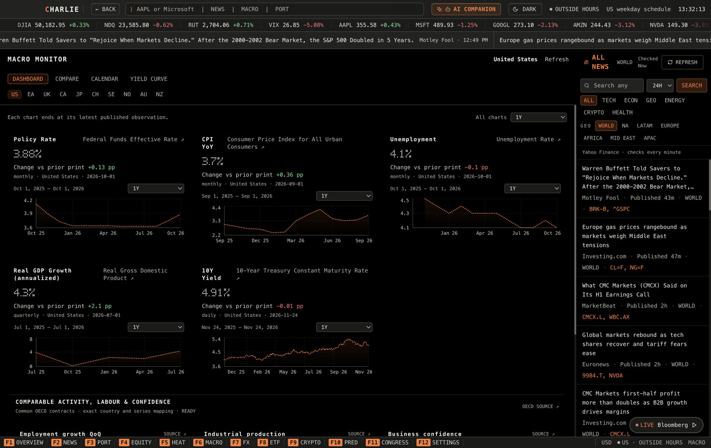
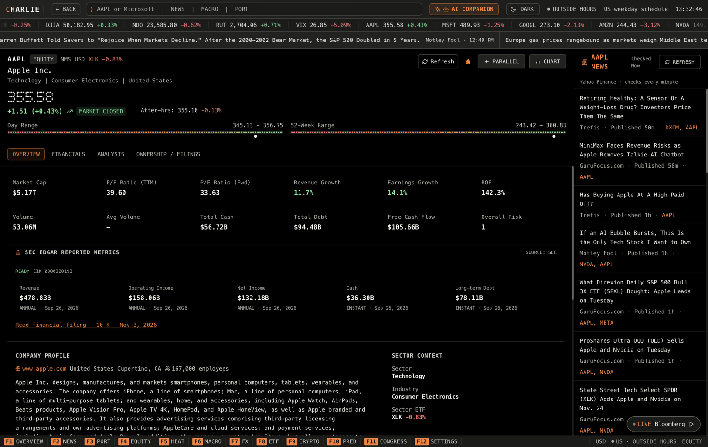

# Charlie

Charlie is a desktop market research app. Build a dashboard around your portfolio and watchlist, investigate a move in a stock or index, and follow the headlines and economic releases behind it. Charlie uses public market data and saves your holdings, layouts, and conversations on your device. An optional AI Companion can explain the chart you’re viewing or search the web with your own OpenAI key.

**Download Charlie for Apple Silicon Macs or Windows** from the [latest GitHub release](https://github.com/alcardaci/Charlie/releases/latest). Linux users can run the app from source.

## Screenshots

**Market Overview** brings the sentiment gauges, index history, and your own watchlist into one customizable dashboard.


| News and geopolitics | Macroeconomics |
| --- | --- |
|  |  |

| Equity research | Equity chart |
| --- | --- |
|  |  |

## Current Feature Set

- **Overview and Portfolio.** Arrange the Overview cards, track symbols with 30-day price charts, and see how your positions, cost basis, and allocation change over time.
- **Equity Research.** Read company profiles and SEC filings, chart prices and moving averages, or open an index to compare its level with its recent history.
- **Earnings Calls.** Open a quarter from Equity Research or a matching earnings event in the calendar. Read management guidance, follow an analyst’s question to the executive’s answer, and compare topics and phrase counts across calls with a free Equibles key.
- **News and Macro.** Follow a scrolling headline feed, review geographic hotspots with source links, and explore economic releases, policy rates, and yields. News tiles can be moved and resized.
- **Predictions and Congressional Trades.** Compare leading Polymarket outcomes side by side. Browse disclosed House and Senate trades by member, ticker, or chamber, with reported amount ranges, filing delays, and links to the original reports.
- **Navigation.** Twelve workspaces share a command bar and keyboard shortcuts. Heatmap, Forex, ETFs, and Crypto provide dedicated market views. Settings includes Help & Shortcuts.

## Install and Run

For a source installation, download the source archive from the [latest release](https://github.com/alcardaci/Charlie/releases/latest) and run these commands from its directory.

```bash
npm ci
npm run desktop:dev
```

On macOS, if the local Electron cache needs to be refreshed:

```bash
npm run fix:electron-mac
npm run desktop:dev
```

## How to Use Charlie

- `HOME` or `OVERVIEW` opens the market overview.
- Typing a ticker such as `AAPL` opens the equity workspace.
- Appending a subcommand changes the destination:
  - `AAPL GP` or `AAPL CHART` opens the chart workspace
  - `AAPL NEWS` opens ticker-specific news
  - `AAPL WL` adds the symbol to the watchlist
- `NEWS`, `GEO`, `PRED`, `MACRO`, `PORT`, `HEAT`, `FX`, `CRYPTO`, `ETF`, `CONGRESS`, and `SETTINGS` jump straight to the matching workspace.
- `ENTER` runs the command, `UP` and `DOWN` browse command history, `TAB` accepts autocomplete, and `ESC` clears or closes the command dropdown.
- `F11` or `CONGRESS` opens Congressional Trades. `F12` or `SETTINGS` opens preferences. `HELP` opens Help & Shortcuts directly.

## Data Sources

- Yahoo Finance via `yahoo-finance2`: equities, ETFs, indices, forex, futures, company fundamentals, search, charts, news, portfolio repricing, and most market screens.
- Teleborsa / FIDA fallback parsing: quote and chart fallback for some fund-like instruments that Yahoo does not cover reliably.
- CoinGecko: crypto prices, rankings, market caps, and breadth inputs.
- U.S. House Clerk, the NexusTrade congressional disclosure snapshot, and congress-legislators supply Congressional Trades. [Coverage and personal-research terms](docs/congressional-trades.md).
- Polymarket Gamma API: prediction-market contracts, probabilities, liquidity, and volume.
- FRED: macro series and release dates used in the macro and calendar views.
- Finnhub: earnings calendar support used in macro views.
- Equibles supplies earnings-call briefs, searchable transcripts, analyst Q&A, and cross-quarter topic and phrase counts. Coverage varies by company and quarter. [Earnings calls API](https://equibles.com/docs/api/endpoints/earnings)
- GDELT DOC 2.0 and Global Knowledge Graph supply articles for the event map and country hotspots.
- Caldara-Iacoviello GPR dataset: geopolitical risk time series and charting.
- Local policy calendar registry: bundled policy-event schedule data.
- OpenAI Responses API: optional overview summaries, general chat and live web research, workspace-aware companion analysis, geopolitics extraction.
- SEC EDGAR: verified ticker/CIK resolution, official filing links, and selected XBRL reported metrics in Equity research; configured through the local proxy and no credentials required.
- BLS, OECD, and Eurostat: bounded public macro trends in the existing Macro view, with homogeneous OECD country comparisons and clearly separated local detail; no credentials required.

## Provider Connections

Open **Settings** (F12) to manage optional API keys or change the model and instructions for the Overview summary. Charlie’s public market feeds work without keys.

- OpenAI powers the Global Event Map, country summaries, and the optional AI features.
- FRED: macro data and release calendars
- Finnhub: earnings calendar support
- Equibles connects **Equity → Earnings Calls** and matching earnings events in the **Events Calendar**. Both open the same four-tab reader. The free plan includes the call analytics and allows 100 requests per day across the REST API and MCP. Charlie caches results and looks up earlier calls, answer text, and phrase counts as you request them. [Get a key](https://equibles.com/dashboard/apikeys) · [Plan limits](https://equibles.com/docs/rate-limits)

On macOS, these credentials are stored in Keychain. On Windows and Linux, they are stored in a local `connections.json` file in the user's Charlie data directory. No private provider keys should be committed to the repository.

SEC EDGAR User-Agent configuration and cache/rate-limit behavior are documented in [docs/sec-edgar.md](docs/sec-edgar.md). Set `SEC_USER_AGENT` only in the local/server environment when a monitored contact should be included; no personal contact data is committed to the repository.

BLS, OECD, and Eurostat macro API behavior is documented in [docs/macro-sources.md](docs/macro-sources.md).
