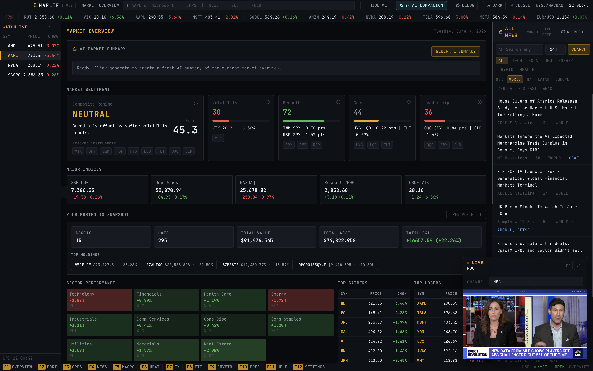
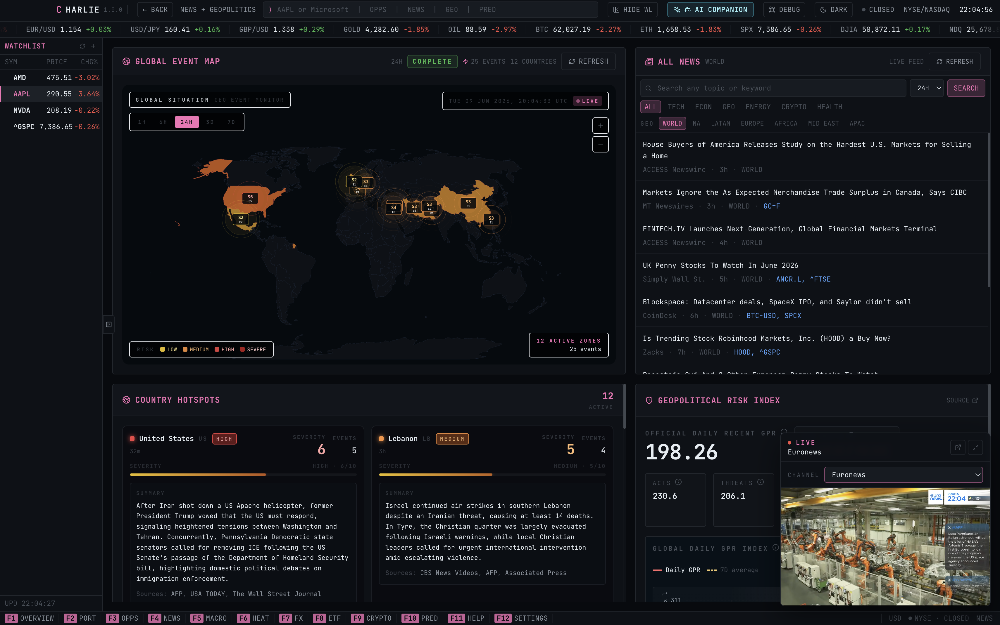
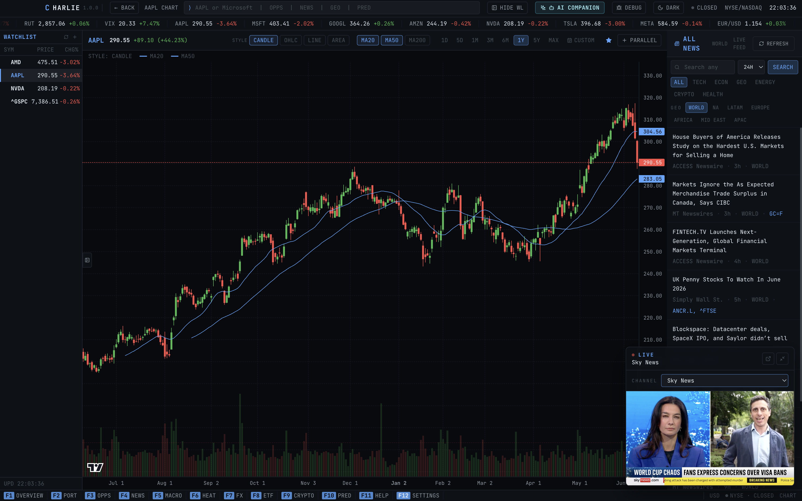

# Charlie

Charlie is a local-first desktop market workspace built with React, Vite, and Electron. It runs as a native app on macOS, Windows, and Linux, and keeps your workspace data, preferences, watchlists, and provider connections local to the machine you are using.

## Screenshots

| Market Overview | News + Geopolitics |
| --- | --- |
|  |  |
| AAPL Research | AAPL Chart |
|  |  |

## Current Feature Set

- Command-driven terminal UI with a top command bar, live market ticker, main panel, status bar, and optional live player. Market Overview pairs the portfolio snapshot with your watchlist and its 30-day price charts.
- Dedicated workspaces for market overview, ticker research, charts, news and geopolitics, prediction markets, macro and yield monitoring, portfolio tracking, sector heatmaps, forex, crypto, ETF monitoring, help, and settings.
- Fast ticker shortcuts such as `AAPL`, `AAPL GP`, `AAPL NEWS`, and `AAPL WL`.
- Optional AI-assisted market summaries, geopolitics extraction, and a general-purpose research companion with autonomous web access and workspace awareness.
- Local persistence for watchlists, portfolio lots, command history, companion conversations, chart style, forex pair selection, and provider settings.

## Install and Run

```bash
npm install
npm run desktop:dev
```

On macOS, if the local Electron cache needs to be refreshed:

```bash
npm run fix:electron-mac
npm run desktop:dev
```

## How to Use Charlie

- `HOME` or `OVERVIEW` opens the market overview.
- Typing a ticker such as `AAPL` opens the equity workspace.
- Appending a subcommand changes the destination:
  - `AAPL GP` or `AAPL CHART` opens the chart workspace
  - `AAPL NEWS` opens ticker-specific news
  - `AAPL WL` adds the symbol to the watchlist
- `NEWS`, `GEO`, `PRED`, `MACRO`, `PORT`, `HEAT`, `FX`, `CRYPTO`, `ETF`, `HELP`, and `SETTINGS` jump straight to the matching workspace.
- `ENTER` runs the command, `UP` and `DOWN` browse command history, `TAB` accepts autocomplete, and `ESC` clears or closes the command dropdown.
- `F1` through `F12` provide shortcut-bar navigation for the core workspaces.

## Data Sources

- Yahoo Finance via `yahoo-finance2`: equities, ETFs, indices, forex, futures, company fundamentals, search, charts, news, portfolio repricing, and most market screens.
- Teleborsa / FIDA fallback parsing: quote and chart fallback for some fund-like instruments that Yahoo does not cover reliably.
- CoinGecko: crypto prices, rankings, market caps, and breadth inputs.
- Polymarket Gamma API: prediction-market contracts, probabilities, liquidity, and volume.
- FRED: macro series and release dates used in the macro and calendar views.
- Finnhub: earnings calendar support used in macro views.
- GDELT DOC 2.0 and Global Knowledge Graph supply articles for the event map and country hotspots.
- Caldara-Iacoviello GPR dataset: geopolitical risk time series and charting.
- Local policy calendar registry: bundled policy-event schedule data.
- OpenAI Responses API: optional overview summaries, general chat and live web research, workspace-aware companion analysis, geopolitics extraction.
- SEC EDGAR: verified ticker/CIK resolution, official filing links, and selected XBRL reported metrics in Equity research; configured through the local proxy and no credentials required.
- BLS, OECD, and Eurostat: bounded public macro trends in the existing Macro view, with homogeneous OECD country comparisons and clearly separated local detail; no credentials required.

## Provider Connections

Charlie works with public/no-key sources out of the box. Optional provider credentials are configured in the `SETTINGS` workspace, not in `.env`, and that workspace also lets you adjust the OpenAI model and prompts used by the AI workflows.

- OpenAI powers the Global Event Map, country summaries, and the optional AI features.
- FRED: macro data and release calendars
- Finnhub: earnings calendar support

On macOS, these credentials are stored in Keychain. On Windows and Linux, they are stored in a local `connections.json` file in the user's Charlie data directory. No private provider keys should be committed to the repository.

SEC EDGAR User-Agent configuration and cache/rate-limit behavior are documented in [docs/sec-edgar.md](docs/sec-edgar.md). Set `SEC_USER_AGENT` only in the local/server environment when a monitored contact should be included; no personal contact data is committed to the repository.

BLS, OECD, and Eurostat macro API behavior is documented in [docs/macro-sources.md](docs/macro-sources.md).
