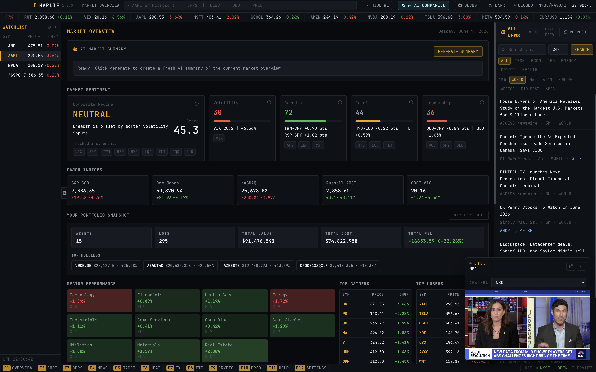
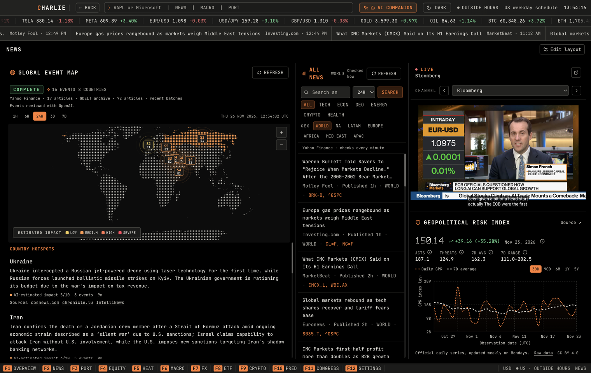
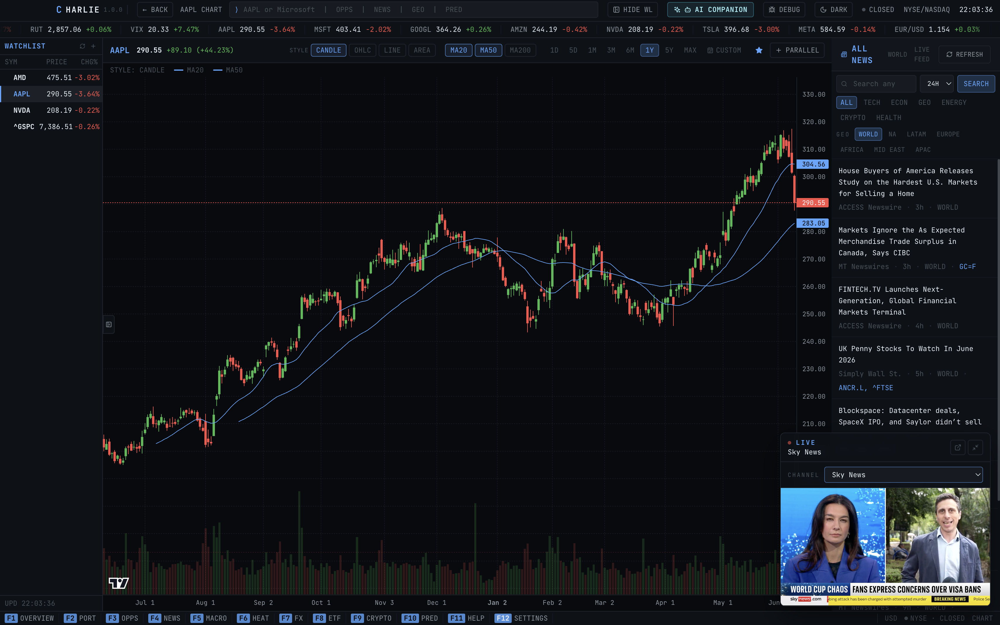

Charlie 1.1 brings a customizable graphite dashboard, index research, and congressional trade disclosures to the desktop app. The core workspaces use public data. AI summaries, event analysis, and web research are optional and use your own OpenAI key.

## What’s new

- **Market Overview.** Move, resize, add, or hide cards. See your watchlist beside your portfolio, compare 30-day index histories, and expand the factors behind the market sentiment score.
- **Equity Research.** Stocks show company profiles, SEC metrics, and original filings. Indices show their level in points, 30 days of closes, and comparisons with the previous close, moving averages, and 52-week range.
- **News and Macro.** Follow headlines from any tab. In News, arrange the event map, headlines, media player, and geopolitical risk chart. Macro charts offer time ranges supported by their sources, and the calendar can be filtered by event type.
- **Predictions and Congressional Trades.** See leading market outcomes together and load more events. Use **F11** to filter House and Senate disclosures by member, ticker, or chamber, check the filing delay, and open the original report. Congressional Trades is for local personal research. [Sources, coverage, and use terms](https://github.com/alcardaci/Charlie/blob/v1.1.0/docs/congressional-trades.md)
- **AI Companion.** Start with a suggested prompt, ask about your current chart, or research a recent event on the web. GPT-6 Luna is the default for new preferences. Replies support formatted text and clickable sources.

## Screenshots

| News and geopolitics | Equity chart |
| --- | --- |
|  |  |

The [full screenshot gallery](https://github.com/alcardaci/Charlie/tree/e95e2d3153e223bf10cbdeb29b2e0764c353dc94#screenshots) also shows Equity Research and Macro.

## Downloads

- **macOS on Apple Silicon (M series).** Download the `.dmg` for installation or the `.zip` for the app bundle. This release has no Apple notarization.
- **Windows.** Choose the setup installer or the portable app for your processor. Most Intel and AMD PCs use x64. Windows on Arm devices use ARM64.
- **Linux.** Use the [source and run instructions](https://github.com/alcardaci/Charlie/tree/v1.1.0#install-and-run).

[Full changelog from 1.0.1](https://github.com/alcardaci/Charlie/compare/v1.0.1...v1.1.0)
