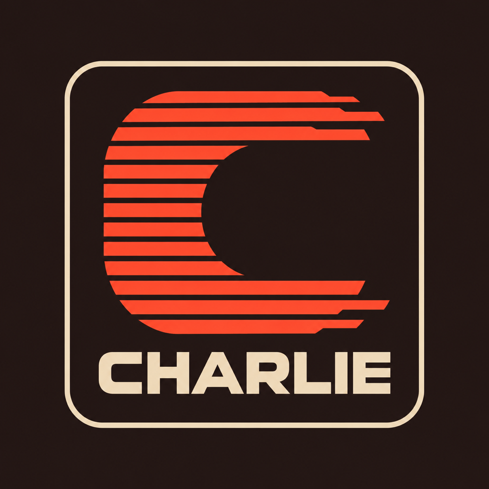

Charlie 1.1.1 brings the new scan-line logo to the toolbar, browser tab, and desktop app icon.

- **macOS on Apple Silicon.** Download the `.dmg` to install Charlie or the `.zip` for the app bundle. This build is unnotarized.
- **Windows.** Choose a setup installer or portable app for x64 or ARM64.
- **Linux.** Use the [source installation instructions](https://github.com/alcardaci/Charlie/tree/v1.1.1#install-and-run).

[Screenshot gallery](https://github.com/alcardaci/Charlie/tree/v1.1.1#screenshots) · [Full changelog](https://github.com/alcardaci/Charlie/compare/v1.1.0...v1.1.1)
